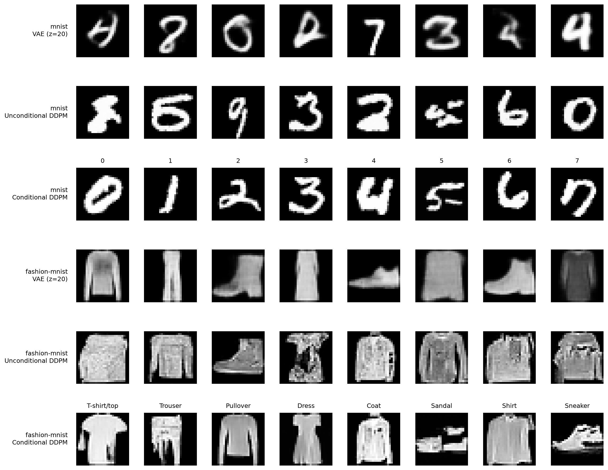

# VAE and Diffusion Models on MNIST and Fashion-MNIST

This project compares three generative models for 28 × 28 grayscale images: a convolutional Variational Autoencoder (VAE), an unconditional Denoising Diffusion Probabilistic Model (DDPM), and a class-conditional DDPM. The experiments use MNIST and Fashion-MNIST to examine generated samples, sampling time, and the effect of class conditioning.

The conditional DDPM achieved **98% classifier agreement on MNIST** and **90% on Fashion-MNIST**, based on 200 generated images per dataset. These scores measure agreement with an evaluation classifier, not image realism or independently verified generation accuracy.

## Project Overview

The project starts with data exploration and a VAE baseline, then trains an unconditional diffusion model and extends it with class conditioning and classifier-free guidance. The final notebook compares the models using saved training metrics, generated images, sampling time, and classifier-based class agreement.

The models and training utilities are implemented in PyTorch, with each experiment documented in a separate notebook.

## Dataset

Two standard image datasets are used:

| Dataset | Images | Classes | Resolution |
|---|---|---:|---|
| MNIST | Handwritten digits | 10 | 28 × 28, grayscale |
| Fashion-MNIST | Clothing and footwear | 10 | 28 × 28, grayscale |

The same dataset preparation procedure and train/validation splits are used across experiments. Downloaded data are not included in the repository; `scripts/prepare_data.py` prepares the datasets locally.

## Methodology

### Generative models

- **Convolutional VAE:** An encoder maps images to a latent distribution, and a decoder reconstructs images or generates new samples from latent vectors. Latent dimensions of **2** and **20** are evaluated.
- **Unconditional DDPM:** A noise-prediction network learns to reverse a gradual noising process. Images are sampled through multiple denoising steps, starting from Gaussian noise.
- **Conditional DDPM:** Class information is included in the noise predictor, allowing specific digits or clothing categories to be requested. Classifier-free guidance is used during sampling.

### Experiment workflow

```text
MNIST / Fashion-MNIST
         ↓
Data exploration and preparation
         ↓
VAE → Unconditional DDPM → Conditional DDPM
         ↓
Saved checkpoints, figures, and training metrics
         ↓
Sample comparison, timing, and class-consistency evaluation
```

The experiments are organized in five notebooks, from dataset exploration to the final model comparison. Model definitions and training code are kept separately in `src/`.

## Results

### Validation losses

| Model | MNIST | Fashion-MNIST |
|---|---:|---:|
| VAE, latent dimension 2 | 144.49 | 257.45 |
| VAE, latent dimension 20 | 97.07 | 235.60 |
| Unconditional DDPM | 0.03973 | 0.06933 |
| Conditional DDPM | 0.03953 | 0.07028 |

The VAE objective combines reconstruction and KL-divergence terms, while the DDPM objective measures noise-prediction error. **Loss values should not be compared directly between these model families.** The two diffusion variants achieved similar validation losses.

### Generated samples



The VAE tends to produce smoother samples, while the diffusion models generally show more defined structures, although some images remain ambiguous. The conditional model allows the requested class to be specified.

### Sampling time

The following measurements were recorded for batches of eight MNIST images:

| Model | Median time per batch |
|---|---:|
| VAE (latent dimension 20) | 0.0004 s |
| Unconditional DDPM | 0.6950 s |
| Conditional DDPM | 1.1163 s |

The VAE requires a single decoder pass, whereas diffusion models perform multiple denoising steps. The conditional model also incurs additional computation from classifier-free guidance. Times depend on the hardware and sampling configuration.

### Class consistency

An evaluation classifier was used to check whether conditional samples matched their requested categories. Each dataset was evaluated using **20 generated samples per class** (200 images total).

| Dataset | Classifier agreement | Classifier test accuracy |
|---|---:|---:|
| MNIST | **98%** | 98.59% |
| Fashion-MNIST | **90%** | 87.49% |

Fashion-MNIST showed greater variation between classes; **Coat** had the lowest agreement at **60%**. These measurements depend on the evaluation classifier and do not directly measure image realism or diversity.

## Repository Structure

```text
vae-diffusion/
├── notebooks/
│   ├── 01_data_exploration.ipynb
│   ├── 02_vae.ipynb
│   ├── 03_diffusion.ipynb
│   ├── 04_conditional_diffusion.ipynb
│   └── 05_model_comparison.ipynb
├── src/
│   ├── models.py
│   ├── training.py
│   ├── diffusion.py
│   ├── diffusion_training.py
│   ├── conditional_diffusion.py
│   └── conditional_training.py
├── scripts/
│   ├── check_environment.py
│   └── prepare_data.py
├── results/
│   ├── figures/
│   └── metrics/
├── environment.yml
├── requirements.txt
└── README.md
```

Model checkpoints and downloaded datasets are excluded from Git. Experiment figures and evaluation metrics are retained.

## Installation

Clone the repository and create the Conda environment:

```bash
git clone https://github.com/StefanoMeAn/vae-diffusion.git
cd vae-diffusion
conda env create -f environment.yml
```

Activate the environment defined in `environment.yml`, then verify the installation:

```bash
python scripts/check_environment.py
```

## Usage

Prepare the datasets:

```bash
python scripts/prepare_data.py
```

Open JupyterLab and run the notebooks in numerical order:

```bash
jupyter lab
```

The VAE and diffusion training notebooks save checkpoints locally. The final comparison notebook requires these checkpoints to load the trained models and regenerate samples. Previously saved metrics and figures are available in `results/` without retraining.

## Limitations and Future Work

- The experiments use small networks and 28 × 28 grayscale images; results may differ for higher-resolution datasets.
- Only one training seed was used, so variability across independent runs was not assessed.
- Visual inspection and classifier agreement do not fully characterize sample quality or diversity.
- Distribution-level metrics such as FID could provide an additional comparison, with appropriate care for small grayscale images.
- Larger architectures and alternative diffusion sampling schedules could be explored to study quality and generation speed.

## Technologies

Python · PyTorch · torchvision · NumPy · pandas · Matplotlib · Jupyter · Conda · CUDA

## Author

**Stefano Meza** — Physicist with a Master’s degree in Physics of Data from the University of Padova, interested in machine learning, deep learning, computer vision, NLP, and scientific computing.

[LinkedIn](https://www.linkedin.com/in/stefanomean/) · [GitHub](https://github.com/StefanoMeAn)
